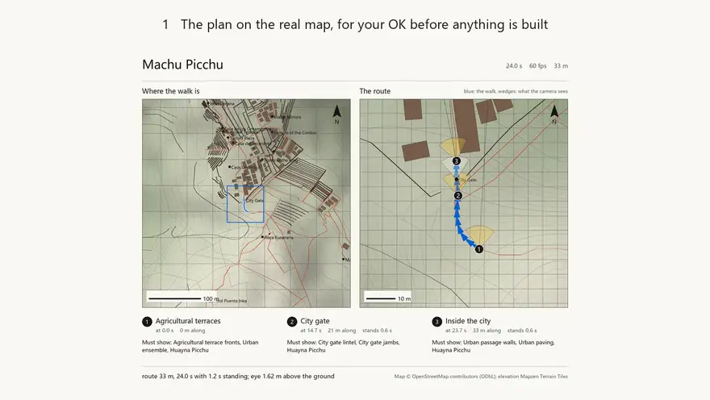
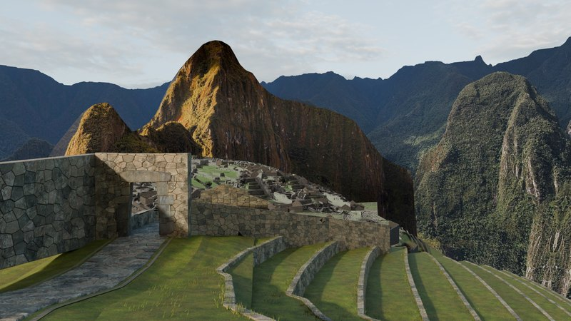
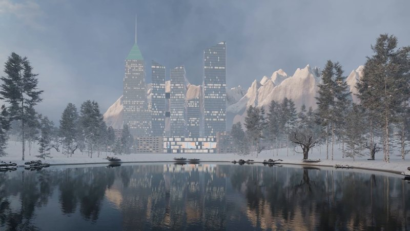
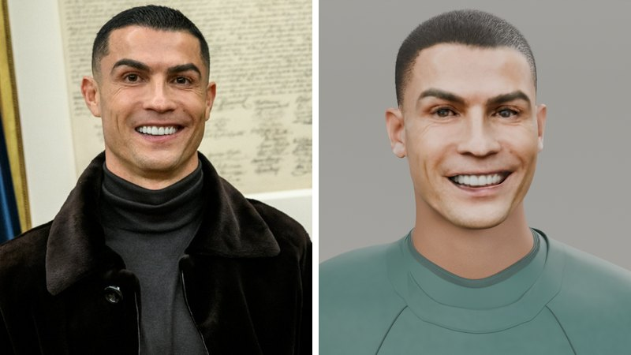
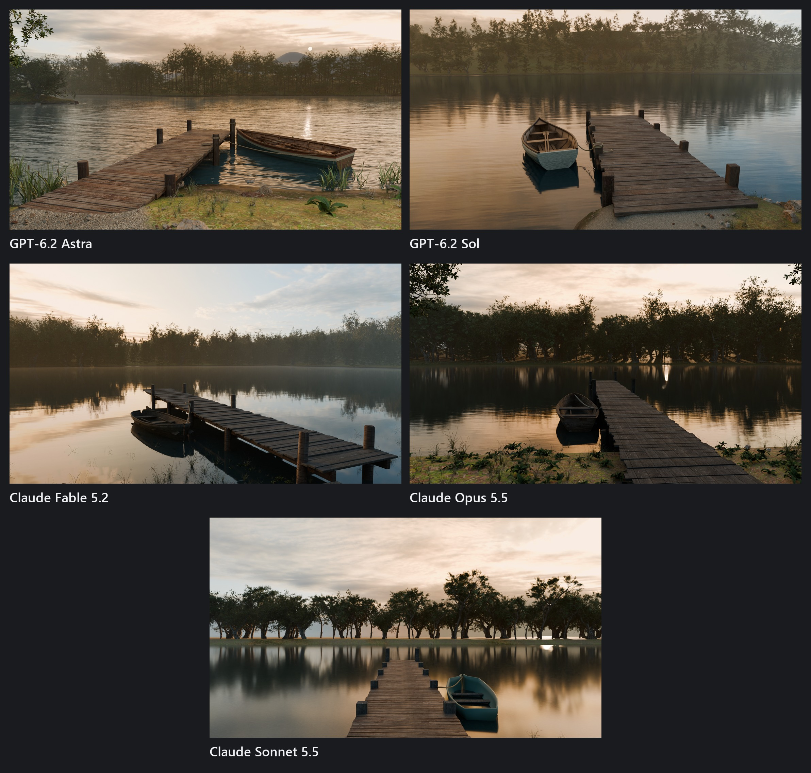

<p align="center"></p>

<h1 align="center">Likeness</h1>

<p align="center">Let your agent build any 3D scene in Blender and carry it through to something people can use: a still, a turntable, a walk-through film, a web page you scroll through, or a GLB. When the scene is a real place or thing, it is matched to photographs, maps and elevation.</p>

<p align="center">A skill for Claude Code and Codex</p>

<p align="center"><a href="README.md">English</a> | <a href="README.zh-CN.md">简体中文</a></p>

[](media/demo.mp4)

Machu Picchu, from the terraces through the city gate. GPT-6.2 Astra built it in Codex with this skill, starting from an empty folder: one session of 3 h 38 min and 59 million tokens, most of them cached context. Three rented RTX 4090s rendered the 1440 frames for 1.89 USD. [Open the page](https://narmi924.github.io/likeness/) and scroll; the scripts are in [examples/machu-picchu](examples/machu-picchu).

## Made with Likeness

| Machu Picchu | A walk round a lake |
|---|---|
| [](https://narmi924.github.io/likeness/) | [](https://www.imranjan.cn) |
| The terraces and the city gate, from photographs, OpenStreetMap and elevation. The page above. | The 3D home page of my site, [imranjan.cn](https://www.imranjan.cn): 114 seconds past four real places, scrolled at 60 fps on a laptop. |
| **Cristiano Ronaldo** | **The World Cup trophy** |
|  |  |
| A portrait fitted to photographs. Left, a [November 2025 photograph](https://commons.wikimedia.org/wiki/File:President_Donald_Trump_meets_with_Cristiano_Ronaldo_in_the_Oval_Office_(54933344262)_(cropped_and_rotated).jpg) (public domain); right, the model. | An object in gold with its two malachite bands, lit as a studio still. |

Five models used Likeness to film the same walk along a gravel path at dusk, stopping with a wooden jetty, the boat tied alongside and the woods across the lake in view.



## Why

The 3D home page of my site began as a real-time scene. On my laptop's integrated graphics it ran at 29 to 36 fps and looked flat, so I rebuilt it as a film rendered ahead in Blender that the page plays as you scroll.

Likeness keeps the method and the tools from that work, so an agent can take the next scene from a brief to a finished result. What I could use before, and what each still left to me:

| Existing tool | What it does well | What is still left |
|---|---|---|
| [MCP for Blender](https://github.com/ahujasid/mcp-for-blender) (35k stars) | The agent runs Python in Blender, looks at viewport and rendered views, imports Poly Haven and Sketchfab assets | No map or elevation import, no shot plan, no final render, film or page |
| [arjun988/blender-skills](https://github.com/arjun988/blender-skills), [EL4CTEO/blender-skills](https://github.com/EL4CTEO/blender-skills) (4.6k, 2.6k) | Many modelling skills, reference-photo matching, heightmap terrain, turntables, web GLB export | No real elevation or OpenStreetMap data, no plan sign-off, no film or page |
| [BlenderGIS](https://github.com/domlysz/BlenderGIS), [Blosm](https://github.com/vvoovv/blosm) (9.7k, 2.2k) | Import OpenStreetMap, elevation and roof shapes into Blender | Driven by hand through menus; look, camera, render and delivery are yours |
| [AnyScene](https://github.com/apekshik/anyscene) (443) | Agents build lit interiors with a critic and a render farm, and output walkthrough shots | Every prop is generated, so the place is plausible rather than surveyed; interiors only |
| [scroll-world](https://github.com/oso95/scroll-world) (11k), [ScrollyVideo.js](https://github.com/dkaoster/scrolly-video) (1.1k) | Pages that scrub a film as you scroll | The film comes from AI video or from you; there is no 3D scene to correct or render again |
| [Google Earth Studio](https://www.google.com/earth/studio/) | Camera flights over Google's 3D imagery | The place can't be changed, the Google credit stays on screen, the page is yours to build |

Likeness joins these steps. The agent decides first how the result will be seen, gathers what the scene should look like (for a real place: the map, the elevation and photographs), and draws the route and every camera stop. It waits for your OK, then builds the scene, renders and looks after every change, asks a second agent to judge only the pictures, and delivers the film, the page and the editable `.blend`.

## Quick start

Paste this to your agent:

```text
Install the Likeness skill from https://github.com/narmi924/likeness: clone it into ~/.claude/skills/likeness
(for Codex: ~/.codex/skills/likeness), run `python scripts/likeness.py setup --get` inside it, and tell me
what it downloaded and where.
```

Or by hand:

```bash
git clone https://github.com/narmi924/likeness ~/.claude/skills/likeness      # Codex: ~/.codex/skills/likeness
python ~/.claude/skills/likeness/scripts/likeness.py setup --get
```

`setup` uses the Blender (5.2 or later), FFmpeg and Python you already have, and downloads what is missing into one folder: Blender 5.2 LTS (about 400 MB) and FFmpeg on Windows and Linux, numpy and Pillow, and the 11 Poly Haven assets the starter scene uses. On macOS, install Blender and FFmpeg first with `brew install --cask blender` and `brew install ffmpeg`. On Ubuntu and Debian, `setup` asks for `sudo apt install python3-numpy python3-pil`.

The folder is `%LOCALAPPDATA%\likeness` on Windows, `~/Library/Application Support/likeness` on macOS and `~/.local/share/likeness` on Linux. To keep it on another drive, put `{"home": "E:/likeness"}` in `local.json` next to `SKILL.md`.

Then ask for something:

```text
Use likeness to build the main gate of Machu Picchu as a 20-second walk I can scroll through on a web page.
```

Tested on Windows 11 and on Ubuntu 24.04 under WSL. macOS has not had a full run yet; if something breaks there, an issue or a pull request is welcome.

## What to ask for

- **Any scene you can describe.** An invented street at dusk, a product on a table, a room, a landscape. The agent blocks it out, renders after every change and looks at the picture before the next one.
- **A real place.** The agent pulls elevation and OpenStreetMap outlines round a point (`likeness place`), finds photographs, and draws the plan on that map (`likeness plan`): the whole site, the route in detail, and a card for each stop with when the walk gets there and what it must show. It models nothing until you reply.
- **A walk through it, for a web page.** The scene is rendered ahead as a film. The page plays it as you scroll, forwards and back, at 60 fps on an ordinary laptop. Labels, clickable spots, snow and rain are drawn live on top.
- **The town and the weather round it.** OpenStreetMap footprints raised to their tagged heights with windows, curtains and rooms that light at dusk; a far city on the skyline; mountains with a snow line; snow on whatever faces up, wet ground with puddles, rain streaks down walls; bare winter trees and snow on firs. On the page, snow, rain and blowing sand fall live over the film, and each stretch of the walk can have its own music.
- **A still, a turntable or a GLB** of a building or a product, compared side by side with the photographs.
- **A long film.** `likeness fleet` rents single-GPU machines on RunPod in the regions you allow and closes each one as soon as its work is home. A separate guard process closes them all at your time or money limit, even if the agent's session has ended.
- **Your own taste.** Write the rules you always want in `references/taste.md`, for example "dusk light" or "keep the camera level on buildings". The agent reads the file before each job and adds rules you state. It stays on your machine and is not part of the repository.

## How it works

**The page.** The film is cut into one-second pieces at several sizes, from 540p to 1440p. The player fetches the pieces round the walker, decodes them with WebCodecs and draws each frame on a WebGL canvas, so scrolling moves through the film in both directions without the stutter of seeking a `<video>` element. The route gives the camera of every frame, so the page can place labels, clickable spots and weather in the picture. It needs a browser with WebCodecs; it has been used in Chrome on Windows and in Safari on iPhone.

**A real place.** `likeness place <lat> <lon> <folder>` pulls elevation from the Terrarium tiles on AWS Open Data (mostly SRTM) and outlines from OpenStreetMap through the Overpass API, and draws a map with a grid in metres. The map, the route and the scene share those metres. The elevation has a sample about every 30 m, so cliffs, ridges and terrace walls are built from photographs. Map data © OpenStreetMap contributors.

**Rendering.** `likeness tools estimate` times real frames before you choose between your own machine and the cloud. `likeness fleet` reads a `fleet.json` with your RunPod key, the card types to try, and a budget. It tests each machine by rendering a few frames twice, shares out one-second pieces, moves work from busy machines to idle ones, brings back only the encoded pieces, and shuts everything down at the end. It counts every machine it rented, including ones that failed their test, and checks with RunPod that each one is gone. The lake film above used eight rented machines; the Machu Picchu demo used three.

**What stays on your machine.** Downloads go to the folder above. `local.json` and `references/taste.md` are your settings and taste. Likeness sends nothing anywhere except the downloads and the map and elevation requests.

## License

MIT. Poly Haven assets and the Blender Studio human base meshes, both downloaded on first use, are CC0. The demo media and the images in `examples/machu-picchu` made from photographs are CC BY-SA 3.0; their sources are listed in that folder. The sculpt, retopology, rig, hair and interface tools adapted from Scenario Blender Skills keep their MIT notice in `scripts/modeling/Scenario-MIT.txt`.
