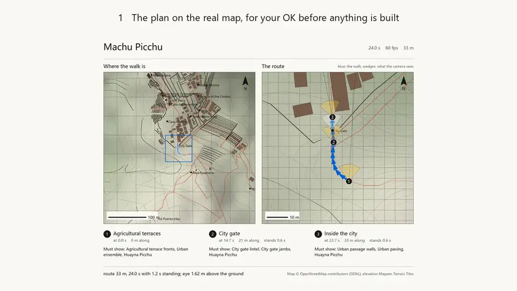

[English](README.md) | [简体中文](README.zh-CN.md)

# Likeness

给 Claude Code 和 Codex 用的技能：照着照片、地图轮廓和高程，用 Blender 把一个真实的地方或一件东西做成 3D，并一直做到能直接用的成品：单张图、转台、走进去的片子、滚动就能往前走的网页，或者 GLB 模型。

[](media/demo.mp4)

[打开这个网页](https://narmi924.github.io/likeness/)，往下滚就往前走。这是 GPT-6.2 Astra 在 Codex 里用这个技能从一个空文件夹做出来的；租了 3 台 RTX 4090 渲完 1440 帧，花了 1.89 美元。脚本在 [examples/machu-picchu](examples/machu-picchu)。

## 为什么做

我的网站 [imranjan.cn](https://www.imranjan.cn) 的 3D 首页，最早是实时渲染的场景。在我这台核显笔记本上只有每秒 29 到 36 帧，画面也发平。2026 年 11 月我把它改成在 Blender 里提前渲染好的片子：沿湖走一圈，经过四个真实的地方，114 秒，6840 帧，2560×1440，每秒 60 帧。租了 8 台显卡机器，2 小时 5 分钟渲完，花了 24.40 美元。现在滚动页面就是在这条片子里走，同一台笔记本上每秒 60 帧。

Likeness 留下了那次的做法和工具，让智能体能从一段需求一路做到成品。动手之前我能用上的工具，和它们留给我自己做的部分：

| 现有工具 | 做得好的地方 | 做一个真实的地方还差什么 |
|---|---|---|
| [MCP for Blender](https://github.com/ahujasid/mcp-for-blender)（3.5 万星） | 智能体在 Blender 里跑 Python，看视口和渲染图，导入 Poly Haven 和 Sketchfab 素材 | 不能导入地图和高程，没有镜头方案，不出最终渲染、片子和网页 |
| [arjun988/blender-skills](https://github.com/arjun988/blender-skills)、[EL4CTEO/blender-skills](https://github.com/EL4CTEO/blender-skills)（4600 星、2600 星） | 大量建模技能，对照参考照片建模，用高度图做地形，转台，导出网页用的 GLB | 没有真实高程和 OpenStreetMap 数据，开建前不等确认，不出片子和网页 |
| [BlenderGIS](https://github.com/domlysz/BlenderGIS)、[Blosm](https://github.com/vvoovv/blosm)（9700 星、2200 星） | 把 OpenStreetMap、高程和屋顶形状导进 Blender | 要自己一步步点菜单；画面、镜头、渲染和交付都靠自己 |
| [AnyScene](https://github.com/apekshik/anyscene)（443 星） | 智能体搭出打好光的室内场景，有评审，有渲染农场，出漫游镜头 | 道具全是生成的，场景像真的但不是照实测做的；只做室内 |
| [scroll-world](https://github.com/oso95/scroll-world)（1.1 万星）、[ScrollyVideo.js](https://github.com/dkaoster/scrolly-video)（1100 星） | 滚动就能拖动片子的网页 | 片子来自 AI 视频或者你自己；没有 3D 场景可以改了再渲 |
| [Google Earth Studio](https://www.google.com/earth/studio/) | 在谷歌的 3D 影像上飞镜头 | 地方本身改不了，画面上要一直留着谷歌的标注，网页要自己做 |

Likeness 把这些步骤围着一个照实测做的地方串起来。智能体先定成品给人怎么看，拉下地图和高程，找照片，把路线和每个镜头停靠点画在真实地图上。等你回复同意后再建场景，每改一处就渲染出来看，再请另一个智能体只看画面挑毛病，最后交付片子、网页和能继续改的 `.blend` 文件。

## 快速开始

把这段话发给你的智能体：

```text
从 https://github.com/narmi924/likeness 安装 Likeness 技能：克隆到 ~/.claude/skills/likeness
（Codex 用 ~/.codex/skills/likeness），在里面运行 `python scripts/likeness.py setup --get`，
然后告诉我它下载了什么、放在哪。
```

也可以自己装：

```bash
git clone https://github.com/narmi924/likeness ~/.claude/skills/likeness      # Codex：~/.codex/skills/likeness
python ~/.claude/skills/likeness/scripts/likeness.py setup --get
```

`setup` 直接用本机已有的 Blender（5.2 或更新）、FFmpeg 和 Python，缺的才下载，全部放进一个文件夹：Windows 和 Linux 上的 Blender 5.2 长期支持版（约 400 MB）和 FFmpeg，numpy 和 Pillow，以及起步场景用到的 11 个 Poly Haven 素材。macOS 上先用 `brew install --cask blender` 和 `brew install ffmpeg` 装好 Blender 和 FFmpeg。Ubuntu 和 Debian 上，`setup` 会提示运行 `sudo apt install python3-numpy python3-pil`。

这个文件夹在 Windows 上是 `%LOCALAPPDATA%\likeness`，macOS 上是 `~/Library/Application Support/likeness`，Linux 上是 `~/.local/share/likeness`。想放到别的盘，在 `SKILL.md` 旁边的 `local.json` 里写 `{"home": "E:/likeness"}`。

然后提需求：

```text
用 likeness 把马丘比丘古城正门做成一段 20 秒、能在网页里滚动着走的片子。
```

已在 Windows 11 和 WSL 里的 Ubuntu 24.04 上完整跑过。macOS 还没有完整跑过，遇到问题欢迎提 issue 或直接发修复的 PR。

## 能做什么

- **真实的地方。** 智能体按经纬度拉下周围的高程和 OpenStreetMap 轮廓（`likeness place`），找照片，把方案画在这张地图上（`likeness plan`）：整个地方、路线细部，每个停靠点一张卡片，写着第几秒走到、要拍到什么。你回复之前它不动手建模。
- **在里面走一段，放进网页。** 场景提前渲染成片子，网页随滚动前后播放，普通笔记本上每秒 60 帧。文字、可点的位置、雪和雨在网页里实时叠在画面上。
- **周围的城镇和天气。** 按 OpenStreetMap 轮廓和标注的层高立起楼，有窗、窗帘，黄昏时一部分房间亮灯；地平线上的一片城；带雪线的山；朝上的面积雪，湿地面和水洼，墙上的雨痕；落了叶的树和挂雪的针叶。网页上的雪、雨和沙在片子上方实时落下，每一段路可以配自己的音乐。
- **楼或产品的单张图、转台或 GLB 模型**，和照片并排对比着做。
- **长片子。** `likeness fleet` 在 RunPod 上你允许的机房里租单卡机器，每台的活一取回就关机。另有一个看守进程，到了你定的时间或花费上限就把机器全部关掉，智能体的会话断了也照样关。
- **你自己的口味。** 把一直想要的规矩写进 `references/taste.md`，比如“黄昏的光”“拍楼时镜头放平”。智能体每次动手前先读，你说出新规矩时它会记进去。这个文件只留在你的电脑上，不在仓库里。

## 怎么做到的

**网页。** 片子切成一秒一段，有 540p 到 1440p 几档。播放器只取当前位置前后的几段，用 WebCodecs 解码，画到 WebGL 画布上，所以滚动时前后都顺，没有拖动 `<video>` 那种卡顿。路线给出每一帧的镜头，网页据此把文字、可点的位置和天气放进画面。需要支持 WebCodecs 的浏览器；在 Windows 上的 Chrome 和 iPhone 上的 Safari 里用过。

**真实的地方。** `likeness place <纬度> <经度> <文件夹>` 从 AWS 开放数据上的 Terrarium 瓦片拉高程（大多来自 SRTM），从 OpenStreetMap 经 Overpass 接口拉轮廓，画成一张带米数网格的地图。地图、路线和场景用的是同一套米数。高程大约 30 米一个点，悬崖、山脊和梯田的墙要照着照片建。地图数据 © OpenStreetMap 贡献者。

**渲染。** `likeness tools estimate` 先实测渲几帧，再决定用本机还是云上。`likeness fleet` 读一个 `fleet.json`，里面是你的 RunPod 密钥、要试的显卡型号和预算。每台机器先把几帧测试图渲两遍，通过了才开工；按一秒一段分活，忙的机器的活挪给闲的，只取回编码好的片段，最后全部关机。租过的每一台都算钱，包括测试没通过退掉的，每台关机后都向 RunPod 核实确实没了。上面那条湖的片子用了 8 台租来的机器，马丘比丘的演示用了 3 台。

**哪些东西留在你电脑上。** 下载的东西都在上面那个文件夹。`local.json` 和 `references/taste.md` 是你的设置和口味。除了下载和地图、高程请求，Likeness 不往外发任何东西。

## 许可

MIT。Poly Haven 素材和 Blender Studio 人体基础网格都在第一次用到时下载，授权是 CC0。演示视频和 `examples/machu-picchu` 里由照片做出的图片是 CC BY-SA 3.0，来源列在那个文件夹里。改编自 Scenario Blender Skills 的雕刻、拓扑、绑定、头发和界面工具，保留它们的 MIT 声明，见 `scripts/modeling/Scenario-MIT.txt`。
