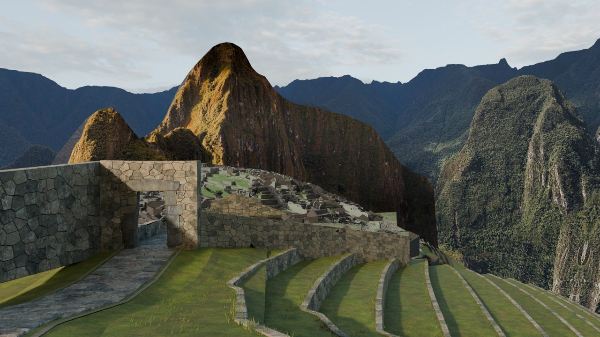
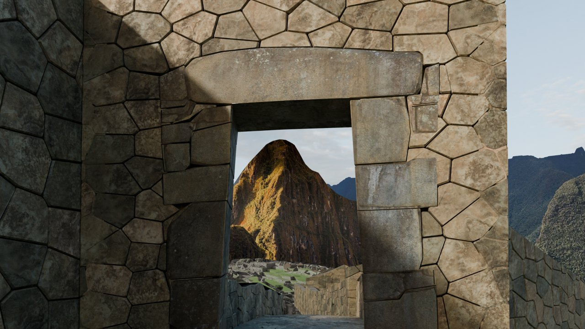
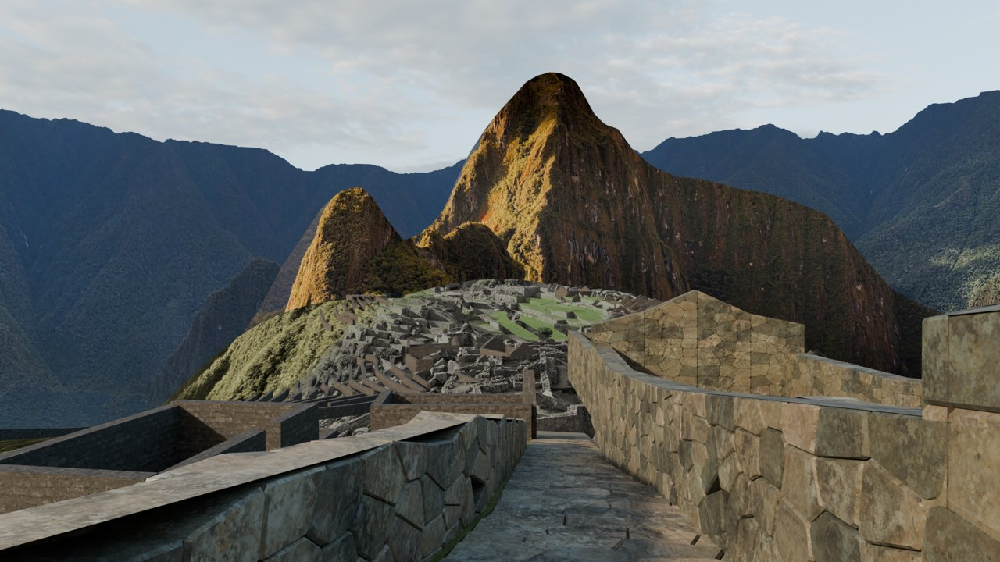

# Machu Picchu: from the terraces through the city gate

A 24-second walk at 1920×1080 and 60 fps: the edge of the agricultural terraces, the city gate, and the stone path inside the city, with Huayna Picchu in view throughout. GPT-6.2 Astra built it in Codex with this skill on 2026-11-22, starting from an empty folder. Three rented RTX 4090s rendered the 1440 frames for 1.89 USD.

| First frame | At the gate | Last frame |
|---|---|---|
|  |  |  |

`plan.png` is the sheet the user approved before anything was built.

## Build it

```bash
L="python <skill>/scripts/likeness.py"
$L edit new build/01-landscape.py tmp/01.blend        # terrain, terraces, walls and the far ranges, in the place's metres
$L edit tmp/01.blend build/02-masonry.py tmp/02.blend # the gate, its stones and the paving
$L edit tmp/02.blend build/03-citadel.py tmp/03.blend # the city beyond the gate and the trail banks
$L edit tmp/03.blend build/04-final-detail.py tmp/site.blend
$L walk route.json tmp/walk.json --ground tmp/site.blend
$L bake tmp/site.blend tmp/walk.json tmp/walk.blend
$L shoot tmp/walk.blend tmp/check --walk tmp/walk.json --frames 0,288,864,1152 --width 960
```

The four scripts and the four check frames take under a minute. Missing Poly Haven textures download into your library on first use. For the film and the page, follow `references/film.md` and `references/web.md`; `build/render-frames.py` is the render command for `likeness fleet`, and `build/finish-page.py` adds the title and credits to the page `likeness web` makes.

## What is in the folder

- `place/`: elevation and OpenStreetMap outlines from `likeness place -13.1645 -72.5456 place --size 3400 --cell 3.4 --zoom 15 --name "Machu Picchu"`, with its map.
- `photos/city-gate.jpg`: the gate photograph, traced for the jambs and lintel and used as their texture.
- `build/*.jpg`, `build/*.npy`, `build/*.csv`, `build/*.json`: what the `prepare-*.py` scripts made from the photographs: the mountain and valley colour projected onto the terrain, the city's colour and relief, the skyline, and the gate's stone joints. To make them again, put the three photographs listed in `sources.md` into `photos/` as `ridge-at-dusk.jpg`, `valley-1.jpg` and `valley-2.jpg`. `prepare-relief.py` also needs `onnxruntime` and the Depth Anything V2 Small ONNX model at `tmp/depth-anything-v2-small.onnx`.

Sources and licences are in `sources.md`. The scripts are MIT like the rest of the skill. The images derived from the photographs, and frames rendered from this scene, are under CC BY-SA 3.0.
